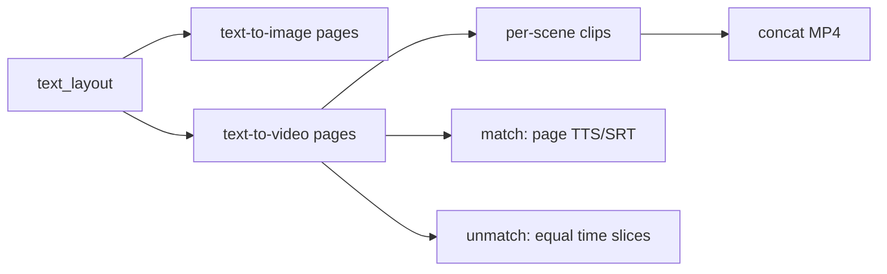

# Requirements

### Overview & Goals
Add `--maxheight` (default 720) to video generation so long copy no longer produces huge frames (e.g. 1268x5924). Paginate wrapped text into scenes. When TTS/subtitle text matches on-screen text, split it with the same scene chunks. When it does not match, do not align words—slice unmatched audio/subs by equal time across scenes.

### Scope
**In scope**
- Shared wrap + paginate used by `text-to-image.py` and `text-to-video.py`
- `--maxheight` on video (default 720); even dimensions; min 640x480 unchanged
- Multi-scene video via per-scene ffmpeg clips then concat
- Matching TTS/SRT: same page chunks as video text
- Unmatched TTS/SRT: equal-duration slices, no word tracking

**Out of scope**
- Forced alignment of different wording
- Changing TTS engines or subtitle mux formats
- Slideshow/PNG-based video path

### Functional Requirements
- Video canvas is `min(maxwidth, content)` × `min(maxheight, content)` with even padding, not unbounded height.
- Overflow lines become additional scenes of equal duration (`duration / N` unless TTS duration is used later).
- Identical display/TTS/subtitle strings → same line groups for speech and SRT cues.
- Different strings → N time slices of the unmatched stream.
- `text-to-image.py` keeps CLI; layout math lives in shared code.

# Technical Design

### Current Implementation
- `text-to-video.py` wraps with `maxwidth` only (lines 95–118) and draws all lines in one `drawtext` clip; height grows without bound.
- TTS is one `say`/`espeak` call; SRT is one cue for the whole duration (`generate_srt`).
- `text-to-image.py` already paginates: `max_chars_per_line` + `max_lines_per_image`, then slices `all_lines` (lines 28–63). CLI already has `--maxheight` default 720.

### Key Decisions
- **Shared layout module** so wrap width and lines-per-page match both tools.
- **Concat clips** (user): one ffmpeg encode per scene, then concat demuxer.
- **Equal time slices** (user) for unmatched TTS/subs; matching text uses the same line pages.

### Proposed Changes
Add `text_layout.py` with the same factors as today (`char_width_factor=0.6`, `line_height_factor=1.5`):
- `wrap_lines(text, fontsize, maxwidth, margin) -> list[str]`
- `paginate_lines(lines, fontsize, maxheight, margin) -> list[list[str]]` (pages)
- `canvas_size(maxwidth, maxheight) -> (w, h)` even, min 640×480

`text-to-image.py` `generate_images` calls these instead of inlined math.

`text-to-video.py`:
- Add `--maxheight` default 720.
- Pages = `paginate_lines(wrap_lines(display_text, ...), ...)`.
- Scene duration = `args.duration / max(1, n_scenes)` (keep `--duration` as total video length).
- If `tts_text == display_text` (after the same file/arg join), TTS each page’s joined lines; else generate one unmatched TTS file and ffmpeg `atrim`/`aselect` into N equal slices (or N TTS calls on equal character/time splits of the unmatched string without trying to match video words—prefer **time-trim of one TTS** so speech is not re-chunked by words).
- Matching SRT: one cue per scene with that page’s text. Unmatched SRT: split the unmatched string into N pieces by **character length or keep full text on each cue with timed windows**—sane default: **N sequential cues of equal duration**, each showing the **entire unmatched subtitle text** (no fake word split). Prefer that over guessing sentence boundaries.
- Concat: write `concat.txt` of scene mp4s, `ffmpeg -f concat -safe 0`.

### Data Models / Contracts
```python
def wrap_lines(text: str, fontsize: int, maxwidth: int, margin: int) -> list[str]: ...
def paginate_lines(lines: list[str], fontsize: int, maxheight: int, margin: int) -> list[list[str]]: ...
def canvas_size(maxwidth: int, maxheight: int) -> tuple[int, int]: ...
```
Matching: `texts_match = (tts_text == display_text)` / `(subtitle_text == display_text)` independently.

### File Structure
- Add `text_layout.py`
- Modify `text-to-image.py`, `text-to-video.py`

### Architecture Diagram


### Risks
- Concat needs identical codecs/timebase; encode all scenes with the same libx264/aac settings.
- TTS shorter/longer than scene slice: pad/trim audio to scene duration.
- Empty last page if `max_lines_per_image` is 0: clamp to at least 1 line.

# Testing

### Validation Approach
Run image and video on a long paragraph; check page count and 1280x720 (or even 720 height) not ~5924.

### Key Scenarios
- Long display text, default maxheight: multiple scenes, 720-tall canvas.
- Same text for display/TTS/subs: SRT cues and spoken chunks follow pages.
- `--tts-text` different: one TTS trimmed into equal slices; SRT equal-duration cues with full unmatched string.
- Short text: single scene, min 640x480 still applies.

### Edge Cases
- maxheight too small for one line: still one line per scene.
- Odd maxwidth/maxheight: even dimensions.
- Image tool still writes `frame_001.png` sequence.

# Delivery Steps

### ✓ Step 1: Extract shared wrap and paginate in text_layout.py
Both tools can compute the same wrapped lines and maxheight pages.
- Add `text_layout.py` with `wrap_lines`, `paginate_lines`, and `canvas_size` using existing 0.6 / 1.5 factors.
- Clamp at least one line per page; even width/height; min 640x480.
- Switch `text-to-image.py` `generate_images` to this module; keep CLI `--maxheight` 720.

### ✓ Step 2: Paginate video with maxheight and concat scene clips
Long video text is split into 720-tall scenes instead of one huge frame.
- Add `--maxheight` default 720 to `text-to-video.py`.
- Build pages via `text_layout`; one lavfi+drawtext encode per page at `duration/N`.
- Concat scene files with ffmpeg concat demuxer into `--output`.

### ✓ Step 3: Sync matching TTS/SRT; equal-time unmatched slices
Matching copy follows scene pages; unmatched audio/subs are time-sliced without word tracking.
- If TTS/subtitle equals display text, generate per-page TTS and SRT cues from the same line groups.
- If not, one TTS file trimmed into N equal `atrim` slices; SRT N equal-duration cues with the full unmatched string.
- Pad/trim audio to each scene length; mux mov_text as today.
